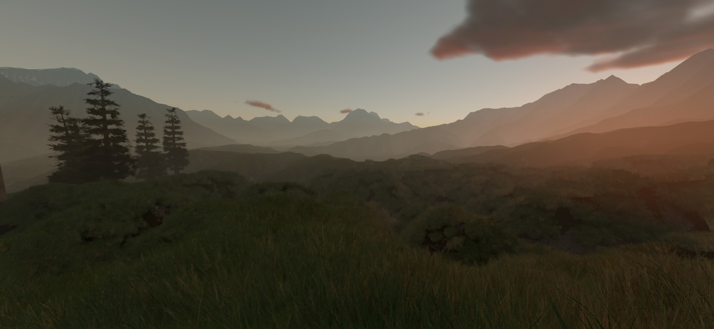
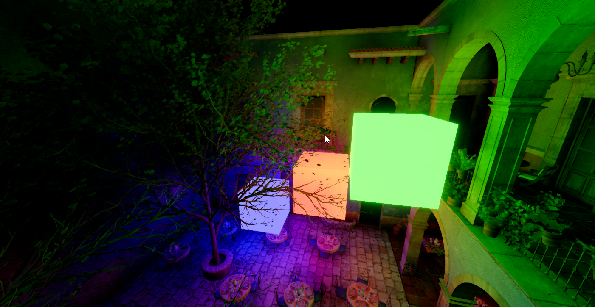
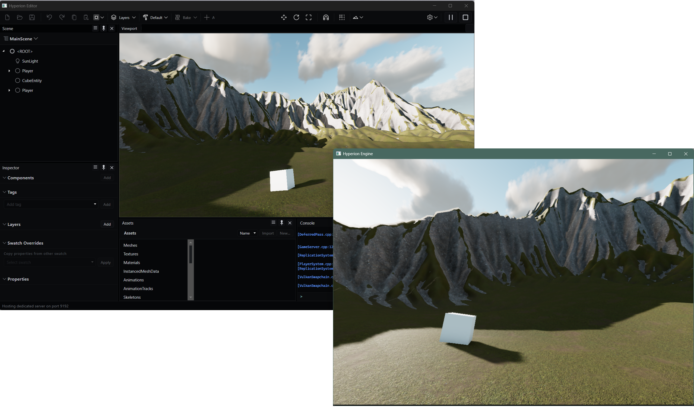
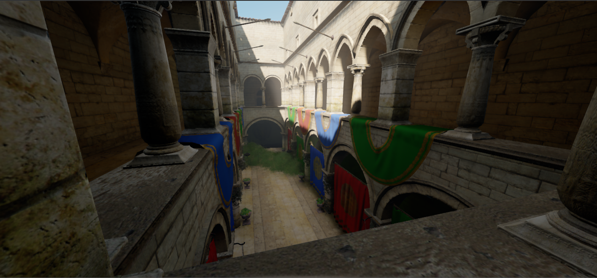
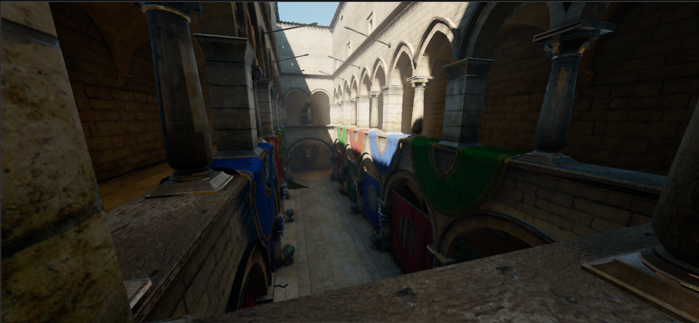

  

    <a href="https://hyperionengine.dev">Website</a> • <a href="https://hyperionengine.dev/docs">Documentation</a> • <a href="https://discord.gg/Fv8PwMJEUb">Discord</a> • <a href="https://hyperionengine.dev/GlideSample">Sample Game (WebGPU)</a>

  

## About

Hyperion is a full-featured modular game engine built from the ground up in C++ and C#, with a focus on atmospheric environments and large worlds that run on devices without hardware RT.

It has been developed continuously since 2016, and is largely built around a custom reflection system that allows for serialization, editor integration, network replication, and scripting to be generated automatically from the same source code.

Along with the renderer and editor, it includes content cooking, asset references that survive renames and moves, level streaming, a dedicated server, and packaging for desktop, mobile, and web.

**[Try the Glide sample in your browser (WebGPU)](https://hyperionengine.dev/GlideSample)**

## Why Hyperion?

- **Dynamic GI on devices without hardware RT.** Glimmer, our GI system, combines voxel GI with software traced probes. Terrain, foliage, and ground cover are part of the GI scene, so it works for large outdoor scenes as well as interiors. Its results can be compared against a reference path tracer built into the engine.
- **Reflection and codegen.** Mark a class, struct, or field for reflection and it can be serialized, edited in the inspector, replicated over the network, and used from C#.
- **Multiplayer you can test in the editor.** Server authoritative replication with client-side prediction and interest management, plus a dedicated server. Play-in-editor can start a server others can connect to, or connect to one that's already running.
- **Content pipeline and packaging.** Content cooking with a shared cache server, UUID-based asset references, level streaming, and packaging from the editor for Windows, Linux, macOS, Android, iOS, and web.
- **Write the entire game in C# or C++.** Use C# for scripting or write the entire game in it. Or generate a C++ project that links to Hyperion, then build and package it from the editor.

## Screenshots
<table>
  <tr>
    <td width="50%" valign="top" align="center">
       
      Glimmer - Emissives
    </td>
    <td width="50%" valign="top" align="center">
       
      Multiplayer, in play-in-editor mode
    </td>
  </tr>
</table>

<!-- |  |  |
| Glimmer - realtime GI | Lightmaps - baked offline, static only | -->

## Features

Click a section header below to expand it:

<b>Rendering</b>

- **Glimmer** - As described above - a hybrid voxel-based + software ray traced probe GI system provides dynamic global illumination without requiring ray tracing hardware
  - Terrain is traced as a heightfield, streamed in around the camera.
  - Sparse foliage voxels light leaves and objects inside tree canopies.
  - Ground cover contributes to the color of light bounced off the terrain.
  - Sun bounce updates as the sun moves, and is dimmed by clouds.
  - Built-in reference path tracer for comparing Glimmer against ground truth, with error stats per surface class.
- **Clustered deferred shading** supporting a large number of dynamic lights while maintaining good frame times, with forward clustered shading for translucent materials.
- **Offline lightmapper** integrated into the editor. Bakes lightmaps into the scene, reflection/irradiance probes supported for dynamic objects, fog volumes, and other static lighting data such as shadow maps.
- Real time reflections via ray tracing on RT capable hardware, with screen-space reflections everywhere else.
- **Automatic instancing.** Entities sharing a mesh, material, and LOD can be batched into instanced draw calls automatically
- Indirect draws, Hi-Z occlusion culling, bindless textures, mesh LODs
- Lights: directional, point, spot, and textured rectangular area lights. Shadow maps for static lights can cache static geometry shadows to improve performance.
- PBR materials with parallax mapping, transmission, emissives, and foliage shading.
- Post: TAA, GTAO, bloom, AgX / ACES / PBR Neutral tonemapping, color grading.
- GPU particles, simulated in compute with depth-buffer collision.
- Backends: DirectX 12 (the default on Windows), Vulkan (Linux, Android, macOS, iOS via MoltenVK), WebGPU.
- Shader compiler system with built in permutations support, and live reload in editor to see changes as you make them.

<b>Gameplay & scripting</b>

- **Scene graph + ECS hybrid.** Entities are nodes in a transform hierarchy and carry plain-data components (mesh, rigid body, character controller, animation, audio, script, UI, ...). Systems run over component sets in execution groups, in parallel where possible.
- **Write it in C# or C++**
  - C# can be used either as a scripting language for gameplay code, or even as your entire game! Look at our CSharpGame sample to see how you can build a game with C#.
  - You can generate a CMake project for your game that links to Hyperion by opening the editor and clicking *Build* > *Generate C++ Project*. From this menu, you can also build and package your game.
- **Reflection and codegen.** Tag a class, struct, or field and it gets serialization, an editor inspector, network replication, and C# + script bindings
- Extend the engine with your own components, systems, world subsystems, `Entity` subclasses, or a `Game` subclass.
- Input: keyboard/mouse, touch with on-screen controls on mobile targets, gamepads via Steam Input. First-person, third-person, and follow camera controllers included.

<b>Editor</b>

- Runs on Windows and macOS, built with Avalonia.
- **Play-in-editor**, Standalone, as client, or against a dedicated server.
- **World building tools:** terrain sculpting and layer painting, ground cover painting, prefab instance painter, decal painter.
- **CSG booleans** (union/subtract/intersect), basic mesh edits, convex collision generation via V-HACD.
- Bake lightmaps, probes, static shadows, and fog volumes

<b>World</b>

- **Terrain:** streamed cells with geomorphic lod (CDLOD). Can be sculpted in the editor. Splat painting supported, as well as procedural splat generation based on the shape of the terrain. Collision is supported via Jolt heightfield shapes.
- **Ground cover and grass:** ground cover is automatically planted onto the terrain on load, can be painted as well.
- **Level streaming:** grid-based world layers streamed around streaming volumes on a dedicated thread
- Procedural atmosphere sky, volumetric clouds with cloud shadows, height fog, and baked fog volumes (baking draws static lights' scattering into a 3D texture)

<b>Networking</b>

- Server authoritative entity replication
- Component replication driven by reflection, entity ownership, and interest management
- Client-side prediction for character movement
- Dedicated server (`--server`)

<b>Physics</b>

- [Jolt](https://github.com/jrouwe/JoltPhysics) backend. Static, dynamic, and kinematic bodies
- Convex decomposition (V-HACD) from the editor.
- Character controller support

<b>Animation</b>

- Skeletal animation with GPU skinning. Import from FBX, glTF

<b>UI</b>

- In-game UI is a custom retained-mode system, drawn by the engine's own renderer (the Avalonia-based editor is unrelated to this).
- Widgets: button, text, textbox, image, panel, grid, list view, tab view, menu bar, etc.
- TrueType/OpenType text via FreeType.

<b>Audio</b>

- 3D positional audio via OpenAL, with the listener following the active camera (note: this will soon be replaced with miniaudio + Steam Audio)

<b>Assets</b>

- Import: FBX, glTF/GLB, OBJ, OgreXML models
- PNG, JPG, TGA, BMP, PSD, HDR, TIF, GIF textures via STB image
- WAV audio
- TTF/OTF fonts
- UUID-based asset registry with redirects, so renaming and moving assets doesn't break references.
- Async batch loading, with memory-mapped blob storage paged in on demand.
- Content cooking, plus a cache server so a team (or your devices) can pull cooked content over HTTP instead of cooking locally.
- Automatic mesh LOD generation, using [meshoptimizer](http://github.com/zeux/meshoptimizer).
- Automatic convex decomposition for physics collision meshes, using [V-HACD](https://github.com/kmammou/v-hacd)

## Platforms
Currently, we are focusing our efforts on developing the engine for *Windows*,  *Linux*, *macOS*, *Android*, *iOS*, *Web* (WebAssembly + WebGPU), and Steam Deck (via Proton). The editor is supported on all desktop platforms. (Windows, Linux, macOS)

## Getting started
Clone with `--recursive` to pull in submodules, then run `build.bat Release` on Windows or `./build.sh Release` on macOS. You'll need CMake and the .NET 10 SDK, plus vcpkg (`VCPKG_ROOT` set) on Windows or the Vulkan SDK on macOS and Android. See [Compiling the Engine](Documentation/CompilingTheEngine.md) for the full list and per-platform notes.

Documentation is a WIP but we have some available on our site: [Documentation](https://hyperionengine.dev/docs)
For any questions you have, please feel free to ask away in [Discord](https://discord.gg/Fv8PwMJEUb).

## AI
AI can be a useful tool, but intention is important when building something super complex like a game engine. We aim to keep the usage of AI-generated code limited to bug fixes, UI changes, and occasionally, prototyping / boilerplate. In an effort to maintain transparency, we aim to note where AI is used generally as part of a commit message, comment on the commit on GitHub, or on the PR; although this is on a best effort basis. 

We expect contributors to be honest and upfront about the usage of AI generated code and while AI-generated code isn’t de facto unacceptable, the code must pass the same quality bar that human generated code would. 

## Credits
- [Avalonia](https://github.com/AvaloniaUI/Avalonia)
- [Dock.Avalonia](https://github.com/wieslawsoltes/Dock)
- [Codicons](https://github.com/microsoft/vscode-codicons)
- [Material Icons](https://github.com/google/material-design-icons)
- [meshoptimizer](https://github.com/zeux/meshoptimizer)
- [V-HACD](https://github.com/kmammou/v-hacd)
- [xatlas](https://github.com/jpcy/xatlas)
- [manifold](https://github.com/elalish/manifold)
- [Jolt Physics](https://github.com/jrouwe/JoltPhysics)
- [FreeType](https://freetype.org/)
- [stb](https://github.com/nothings/stb)
- [OpenAL Soft](https://github.com/kcat/openal-soft)

Full list and licenses in [THIRD_PARTY_NOTICES.md](THIRD_PARTY_NOTICES.md).
